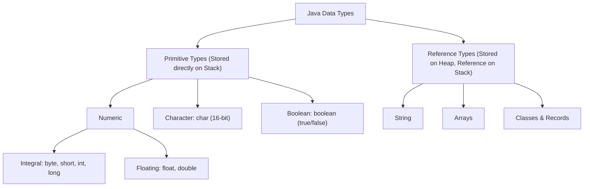
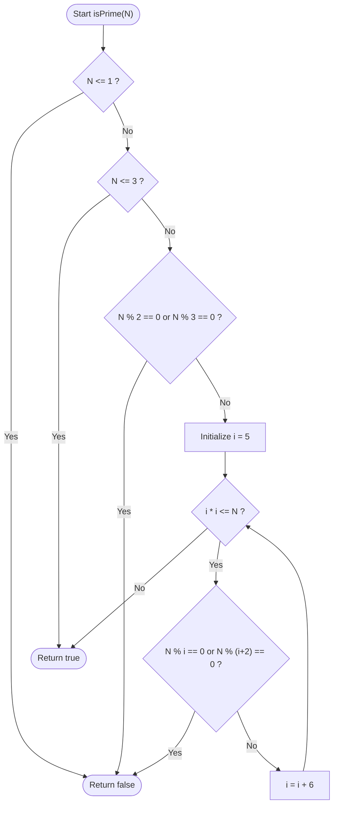

# Week 2: Java Fundamentals — Comprehensive Learning Guide & Assignment

Welcome to the **Week 2 Java Fundamentals** repository. This project covers all fundamental concepts of Java programming with zero-cost learning references, complete source code, architectural explanations, and executable demonstrations.

---

## 📚 Learning Topics & Concept Overview

### 1. Variables & Primitive Data Types
Java is a statically typed language. Every variable must have a declared type before it is used. Java provides **8 primitive data types**:

| Type | Category | Size | Range / Values | Default | Wrapper Class |
| :--- | :--- | :--- | :--- | :--- | :--- |
| `byte` | Integer | 8 bits (1 byte) | -128 to 127 | `0` | `Byte` |
| `short` | Integer | 16 bits (2 bytes) | -32,768 to 32,767 | `0` | `Short` |
| `int` | Integer | 32 bits (4 bytes) | -2,147,483,648 to 2,147,483,647 | `0` | `Integer` |
| `long` | Integer | 64 bits (8 bytes) | -9,223,372,036,854,775,808 to 9,223,372,036,854,775,807 (Use `L` suffix) | `0L` | `Long` |
| `float` | Floating-point | 32 bits (4 bytes) | ~1.4E-45 to ~3.4E+38 (Use `f` suffix) | `0.0f` | `Float` |
| `double` | Floating-point | 64 bits (8 bytes) | ~4.9E-324 to ~1.7E+308 (Standard for decimals) | `0.0d` | `Double` |
| `char` | Text / Character | 16 bits (2 bytes) | 0 to 65,535 (Unicode `\u0000` to `\uffff`) | `'\u0000'` | `Character` |
| `boolean` | Logical | 1 bit (JVM dependent) | `true` or `false` | `false` | `Boolean` |



---

### 2. Type Casting & Overflow Behavior
- **Widening (Implicit) Casting**: Smaller type to larger type without data loss:
  $$\text{byte} \rightarrow \text{short} \rightarrow \text{int} \rightarrow \text{long} \rightarrow \text{float} \rightarrow \text{double}$$
- **Narrowing (Explicit) Casting**: Larger type to smaller type with possible truncation or overflow:
  ```java
  double d = 9.99;
  int i = (int) d; // i becomes 9 (fraction truncated)
  ```
- **Two's Complement Overflow**: Integers wrap around when exceeding maximum values:
  ```java
  byte b = 127;
  b = (byte)(b + 1); // Wraps around to -128
  ```

---

### 3. Operators & Control Flow
- **Arithmetic**: `+`, `-`, `*`, `/`, `%`
- **Relational**: `==`, `!=`, `>`, `<`, `>=`, `<=`
- **Logical**: `&&` (short-circuit AND), `||` (short-circuit OR), `!` (NOT)
- **Ternary Operator**: `condition ? valueIfTrue : valueIfFalse`
- **Switch Expressions (Modern Java)**:
  ```java
  double result = switch (operator) {
      case '+' -> a + b;
      case '-' -> a - b;
      case '*' -> a * b;
      case '/' -> (b == 0) ? throw new ArithmeticException() : a / b;
      default  -> throw new IllegalArgumentException("Unknown operator");
  };
  ```

---

### 4. Loops & Algorithmic Efficiency
- **`for` loop**: Definite iteration with counter.
- **`while` loop**: Indefinite iteration based on pre-condition.
- **`do-while` loop**: Indefinite iteration executing at least once.
- **Enhanced `for-each`**: Clean traversal of arrays and collections (`for (Student s : students)`).
- **Prime Optimization**:
  - Naive trial division: $O(N)$
  - Optimized trial division checking up to $\sqrt{N}$ and step-of-6: $O(\sqrt{N})$
  - Sieve of Eratosthenes for prime ranges: $O(N \log \log N)$



---

### 5. Methods & Basic OOP (Records)
- **Methods**: Modular blocks of code that take parameters, perform actions, and return values.
- **Pass-by-value**: Java passes primitive arguments by copy of value, and object arguments by copy of reference.
- **Modern Java Records (`record`)**:
  Concise syntax for immutable data carriers:
  ```java
  public record Student(String id, String name, double score) {
      public char getLetterGrade() { ... }
  }
  ```

---

## 📁 Project & Package Structure

```
week2/
├── bin/                          # Compiled bytecode (.class files)
│   └── com/
│       └── academy/
│           ├── calculator/
│           ├── grading/
│           ├── primes/
│           └── primitives/
├── src/                          # Java source files (.java)
│   └── com/
│       └── academy/
│           ├── calculator/
│           │   ├── Calculator.java          # Core arithmetic engine & math operations
│           │   └── ConsoleCalculator.java   # Interactive CLI calculator with history
│           ├── grading/
│           │   ├── Student.java             # Immutable student record with grade rules
│           │   ├── StudentGradeManager.java # Roster management, averages, min/max
│           │   └── GradeManager.java        # Interactive console grade system with visual charts
│           ├── primes/
│           │   ├── PrimeFinder.java         # Trial division (O(sqrt(N))) & Sieve of Eratosthenes
│           │   └── PrimeGenerator.java      # Wrapper and generation utility
│           └── primitives/
│               ├── PrimitiveTypesDemo.java  # Full demonstration of all 8 primitive types
│               └── PrimitiveDemo.java       # Quick launcher
└── README.md                     # This documentation guide
```

---

## 🚀 How to Compile and Run

### 1. Compile all Java source files
From the `week2` directory, compile all `.java` files into the `bin/` directory:

```powershell
javac -d bin src\com\academy\primitives\*.java src\com\academy\calculator\*.java src\com\academy\primes\*.java src\com\academy\grading\*.java
```

### 2. Run the Programs

#### Program 1: Primitive Data Types Demonstration
```powershell
java -cp bin com.academy.primitives.PrimitiveTypesDemo
```

#### Program 2: Calculator
- **Automated test run:**
  ```powershell
  java -cp bin com.academy.calculator.Calculator
  ```
- **Interactive Console Calculator:**
  ```powershell
  java -cp bin com.academy.calculator.ConsoleCalculator
  ```

#### Program 3: Prime Number Finder
- **Default run (primes up to 50):**
  ```powershell
  java -cp bin com.academy.primes.PrimeFinder
  ```
- **Custom limit (e.g. primes up to 100):**
  ```powershell
  java -cp bin com.academy.primes.PrimeFinder 100
  ```

#### Program 4: Student Grade Management System
- **Automated Grade Report Demonstration:**
  ```powershell
  java -cp bin com.academy.grading.StudentGradeManager
  ```
- **Interactive Grade Management CLI:**
  ```powershell
  java -cp bin com.academy.grading.GradeManager
  ```

---

## 🌐 100% Free Learning Resources (No Paid Courses Needed)

You do **not** need to pay for Udemy or subscription platforms. The best, most up-to-date Java resources are completely free:

1. **[dev.java — The Official Java Portal](https://dev.java/)**
   - Maintained directly by the Oracle Java Platform Group.
   - Comprehensive tutorials on language fundamentals, modern switch statements, records, and standard libraries.
2. **[University of Helsinki MOOC — Java Programming I](https://java-programming.mooc.fi/)**
   - Internationally acclaimed, free interactive university course with automated exercises.
3. **[Oracle Official Java Tutorials](https://docs.oracle.com/javase/tutorial/)**
   - The authoritative reference for Java language specifications and core libraries.
4. **[Baeldung — Core Java Tutorials](https://www.baeldung.com/category/java/)**
   - Clear, concise, production-oriented articles with code snippets.
5. **[GeeksforGeeks Java Programming](https://www.geeksforgeeks.org/java/)**
   - Easy lookup for algorithmic patterns, syntax, and interview preparation.
